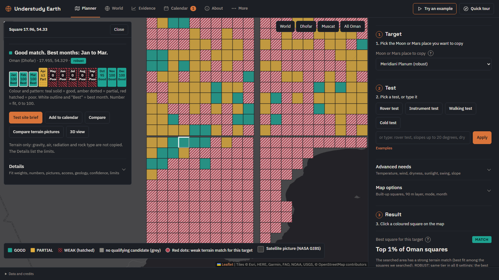
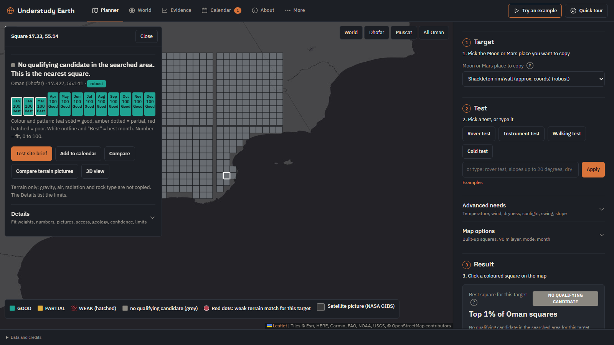
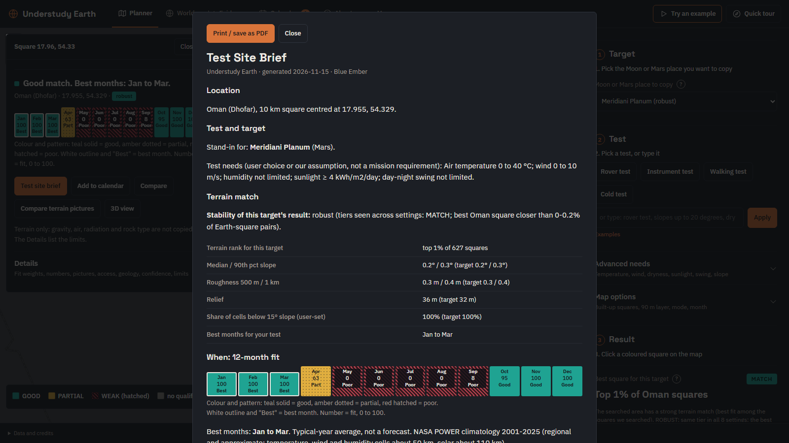

# Understudy Earth

**Where and when on Earth can we rehearse for the Moon and Mars?**

NASA Space Apps Challenge 2026, Challenge 10 ("Identify Earth Locations that Analog the Permanent Moon Base Locations and Mars"). Team **Blue Ember**, Muscat Local Event.

**Live app:** https://samaralhadhrami.github.io/understudy-earth/  (no login, no install, works on phone)
**30-second demo:** DEMO_VIDEO_LINK



## What it does
Pick a Moon or Mars place (for example Jezero crater or Shackleton rim) and describe your test (a rover drive, an instrument test, a walking test, a cold test). The app shows:

- **Where**: Earth ground whose terrain shape (slope, roughness, relief) matches that Moon or Mars place, as 10 km squares on a map.
- **When**: the months of the year when the climate suits your test (temperature, wind, dryness, sunlight, from NASA POWER).
- **Honestly**: when nothing we searched is close enough, the map goes grey and says "no qualifying candidate in the searched area". A high rank is never called a perfect twin.

Then open a square for a one-line verdict, the 12-month strip, same-scale terrain pictures, a 3D view, a printable one-page Test Site Brief and a share link.

| No good match is a valid answer | Test Site Brief |
|---|---|
|  |  |

## Try it in 30 seconds
1. Open the live app and press **Start planning** (or **Try an example**).
2. Choose a Moon or Mars target, then press **Rover test**.
3. Click a green square in Oman. Read the verdict and the best months.
4. Try **3D view**, **Add to calendar**, and the **Click Mars / Moon** page (click a spot or type latitude and longitude).

## What is covered (and what is not)
| Part | Coverage |
|---|---|
| Fine Earth squares (30 m terrain) | Oman: the Muscat area and Dhofar, plus Meteor Crater (Arizona) and an Atacama/Andes tile as outside check sites |
| Coarser Earth squares (90 m terrain) | An optional layer for all Oman, and 45 chosen places worldwide (deserts, volcanic fields, polar and mountain areas) |
| Mars | Click or type any spot from 87 S to 87 N (463 m MOLA data) |
| Moon | Both polar caps, 80 to 90 degrees (south and north) |
| Not covered | The whole of Earth, the GCC or the Middle East as a scored grid. The world view is a chosen set of places, not every place on Earth. |

Results are the best fit among the squares we searched. GCC-wide and global grids are future work.

## How it works
1. **Same scale.** Moon, Mars and Earth terrain models are averaged to 500 m cells and cut into 10 km squares.
2. **Terrain match.** Slope, steepness, roughness at two scales and relief are compared. Each Earth square gets a rank against the chosen target. Top 5% is good, 5 to 20% is partial. A target is a gap when no square is as close as the closest 5% of Earth-square pairs are to each other.
3. **Test needs.** You set temperature, wind, dryness, sunlight and day-night swing. Each month is scored by its weakest factor. These are your needs or our labelled assumptions, never mission requirements.
4. **Where and when.** A square is GOOD only if the terrain matches and a month fits.

Everything is precomputed by the Python pipeline in `pipeline/` into small files in `app/data/`. The browser then scores live with plain JavaScript. There is no server and no AI at runtime.

## Results and limits
- **Baseline check.** Known analog areas such as the AMADEE-18 area (Dhofar) and Meteor Crater rank well above random Earth squares for most Mars targets (random is about 50%).
- **Screening tool.** It narrows down where and when to look. It is not a final site selector, and Earth cannot copy gravity, thin air, radiation or real Moon and Mars temperatures.
- Details: [docs/VALIDATION.md](docs/VALIDATION.md) and [docs/LIMITS.md](docs/LIMITS.md).

## Data and credits
Full list with licences: [docs/REFERENCES.md](docs/REFERENCES.md).
- **NASA:** LRO LOLA (Moon terrain), MGS MOLA (Mars terrain), POWER (climate), HiRISE Jezero terrain model, GIBS (optional satellite layer), THEMIS thermal inertia (context).
- **ESA:** Copernicus DEM GLO-30 and GLO-90 (produced using Copernicus WorldDEM-30 (c) DLR e.V. 2010-2014 and (c) Airbus Defence and Space GmbH 2014-2018 provided under COPERNICUS by the European Union and ESA; all rights reserved), WorldCover.
- **Others:** OpenStreetMap contributors (ODbL, access distances), GLiM lithology (Hartmann and Moosdorf 2012, CC BY 3.0), Meteomatics weather API (Space Apps Challenge partner access; derived values only), Leaflet, Esri tiles.

## Run it yourself
```
python -m http.server 8000 --directory app      # then open http://localhost:8000
pytest                                           # Python tests
node tests/check_js_score.js                     # JS score matches Python
```
Rebuilding the data needs the large source files (Copernicus tiles, LOLA, MOLA, HiRISE) in `data/`, which is not in the repo. See `pipeline/` and [docs/TRD.md](docs/TRD.md).

## Repository map
`app/` static web app and precomputed data | `pipeline/` data processing | `tests/` tests | `docs/` product, method, limits, references

## Use of AI
The idea, the where-and-when planner, the baseline test and the decisions are the author's. The author used **Claude (by Anthropic)**, including Claude Code, for research, critique, code, tests and editing, and checked the output by running tests and reading sources. The app itself uses no AI at runtime (the sentence box is a fixed rule-based matcher). The demo video narration is an AI-generated voice (Kokoro TTS).

## Licence
Apache 2.0. Third-party data keep their own licences (see references).
